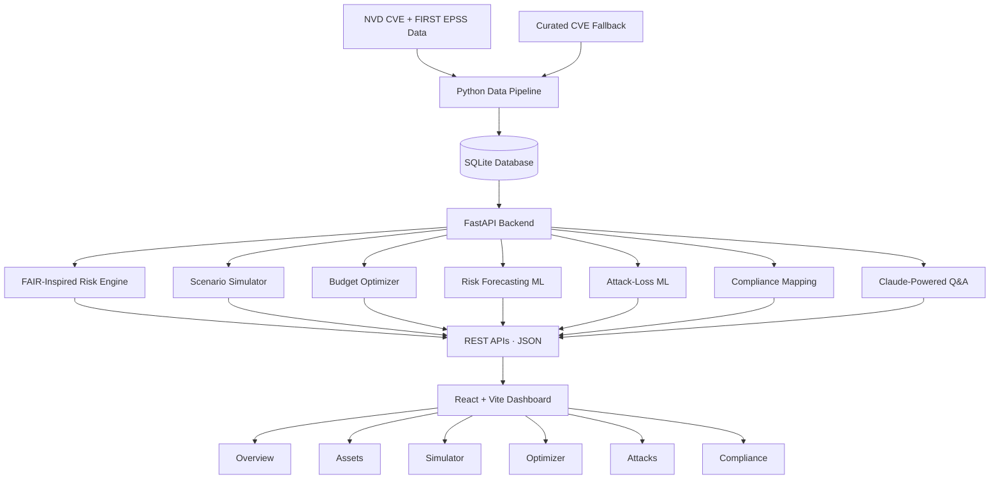

#  AegisQ — Cyber Risk, Quantified.

### From vulnerabilities to financial exposure. From security budgets to smarter investments.

<p align="center">
  <strong>SIH26105 · Smart India Hackathon 2026</strong>
</p>

<p align="center">
  
  
  
  
  
</p>

AegisQ is an AI-powered cyber-risk quantification and security investment optimization platform designed for small and mid-market organizations. It translates technical vulnerabilities into estimated financial exposure, forecasts near-term asset risk, and identifies promising combinations of security controls under a fixed budget.

**The idea is simple: cybersecurity teams shouldn't just know what is vulnerable — they should understand the potential financial impact and where their next security rupee can make the biggest difference.**

---

## The Platform

<!-- Replace this placeholder with a screenshot of your actual dashboard. -->
<!-- Save the screenshot as docs/screenshots/dashboard.png before publishing. -->

<p align="center">
  
</p>

<p align="center">
  <em>A unified view of cyber risk, financial exposure, security investments, attack intelligence and compliance.</em>
</p>

> **Before publishing:** Add a real screenshot at `docs/screenshots/dashboard.png`, or replace the image path with the location of a screenshot committed to the repository. Remove this section if you don't have a screenshot yet.

## The Problem

Traditional vulnerability management often revolves around CVSS scores, CVE counts and technical severity. These indicators are useful, but they don't directly answer the questions business leaders need answered:

- How much financial exposure could our organization face?
- Which assets contribute most to that exposure?
- How might asset risk change in the near future?
- Which security controls should we prioritize?
- How should we allocate a limited security budget?

Security teams need a bridge between technical risk and financial decision-making.

## Our Solution

AegisQ combines risk quantification, historical risk forecasting, scenario simulation and budget optimization in one interactive platform.

Its core workflow is:

<p align="center">
  <strong>Assets + Vulnerabilities</strong><br/>
  ↓<br/>
  <strong>FAIR-Inspired Financial Risk Quantification</strong><br/>
  ↓<br/>
  <strong>Security Control Coverage</strong><br/>
  ↓<br/>
  <strong>Budget-Constrained Optimization</strong><br/>
  ↓<br/>
  <strong>Estimated Risk Reduction + ROSI</strong>
</p>

Instead of recommending controls simply because they are popular, AegisQ evaluates their costs, vulnerability coverage and combined effect on estimated risk.

## AegisQ by the Numbers

The bundled development database provides the following baseline:

| Component | Dataset size |
|---|---:|
| Assets | 52 |
| Vulnerabilities | 112 |
| Security controls | 18 |
| Control–vulnerability mappings | 1,069 |
| Historical risk observations | 4,732 |
| Attack incident records | 100 |

The data foundation supports asset-level risk assessment, control evaluation, historical forecasting and attack-intelligence exploration.

### An illustrative portfolio view

- **~₹136 crore/year** — estimated portfolio exposure from the bundled database.
- **~₹7.7 crore/year** — estimated Expected Annual Loss (EAL) for the highest-exposure asset, AST-045.

These are outputs of the current model and dataset, **not independently verified real-world financial losses**. The estimates depend on modelling assumptions and the quality of the underlying data.

## Core Features

<table>
  <tr>
    <td width="50%">
      <h3> Financial Risk Quantification</h3>
      Converts vulnerability and asset information into estimated financial exposure using a FAIR-inspired risk model.
    </td>
    <td width="50%">
      <h3> ML Risk Forecasting</h3>
      Uses historical risk observations and asset features to predict next-day asset risk scores.
    </td>
  </tr>
  <tr>
    <td width="50%">
      <h3> Scenario Simulator</h3>
      Tests security-control combinations and compares estimated exposure before and after investment.
    </td>
    <td width="50%">
      <h3> Budget Optimizer</h3>
      Evaluates affordable control portfolios, accounting for overlapping control coverage, cost and estimated risk reduction.
    </td>
  </tr>
  <tr>
    <td width="50%">
      <h3> Attack Intelligence</h3>
      Explores historical attack incident records and provides attack-category and threat-actor breakdowns.
    </td>
    <td width="50%">
      <h3> Compliance Mapping</h3>
      Organizes security controls against ISO 27001, NIST CSF, CIS and RBI framework tags.
    </td>
  </tr>
  <tr>
    <td colspan="2">
      <h3> Natural-Language Risk Q&A</h3>
      An optional Claude-powered endpoint answers questions using a supplied live risk snapshot, with graceful handling when the API key is unavailable.
    </td>
  </tr>
</table>

## How the Risk Engine Works

### 1. FAIR-inspired Expected Annual Loss

AegisQ estimates financial exposure using a simplified, transparent model.

The current implementation uses:

- **Loss event frequency proxy:** EPSS score.
- **Loss magnitude proxy:** CVSS severity × asset criticality × a configurable ₹5,00,000 multiplier.

For a vulnerability, the simplified calculation is:

\[
EAL_v = EPSS_v \times CVSS_v \times C_v \times ₹5{,}00{,}000
\]

where \(C_v\) represents the associated asset's criticality in the model.

Asset-level EAL is calculated by summing the estimated losses associated with its vulnerabilities. Portfolio exposure is then aggregated across assets.

The model is FAIR-inspired, rather than a complete implementation of the FAIR standard. In particular, EPSS represents an exploitation-probability estimate over a defined time window; treating it as annual loss-event frequency is a simplifying assumption that requires calibration before real-world financial decisions.

### 2. Security Scenario Simulation

The simulator evaluates how selected controls affect the vulnerabilities they cover.

When multiple controls mitigate the same vulnerability, remaining risk is calculated multiplicatively:

\[
R_{\text{remaining}} = R_{\text{original}}\prod_i(1-r_i)
\]

Here, \(r_i\) is the risk-reduction fraction associated with each applicable control.

This approach prevents overlapping reductions from simply being added together beyond 100%.

The simulator reports the resulting exposure, estimated exposure avoided, control cost and Return on Security Investment (ROSI).

### 3. Budget-Constrained Optimization

AegisQ's optimizer evaluates security-control combinations against a specified budget.

For a catalogue of up to 24 controls, it enumerates affordable subsets and evaluates each portfolio using the combined scenario model. This accounts for overlapping coverage rather than assuming each control provides an independent benefit.

With 18 controls, the full subset space contains:

\[
2^{18}=262{,}144
\]

possible subsets before affordability filtering.

For larger catalogues, the implementation falls back to a greedy marginal-benefit-per-cost strategy.

The optimizer returns the recommended control portfolio, its cost, estimated risk reduction, post-investment exposure, ROSI and an investment curve showing spending against estimated risk avoided.

The recommended controls are selected by the optimization logic, not hard-coded to a predetermined bundle.

## Machine Learning

AegisQ contains two distinct machine-learning workflows. They have different goals and different levels of validation.

| | Risk forecasting | Attack-loss estimation |
|---|---|---|
| Objective | Predict next-day asset risk score | Estimate monetary loss per incident |
| Model | Random Forest regressor | Random Forest preprocessing pipeline |
| Training data | Historical asset-risk observations | 100 incident records |
| Features | Risk lags, rolling statistics, vulnerability and asset characteristics | Incident attributes, CVSS, EPSS and asset characteristics |
| Reported evaluation | MAE ≈ 1.19, RMSE ≈ 1.70, R² ≈ 0.978 | Negative holdout R² in the reported runs |
| Current role | Risk forecasting baseline | Experimental calibration signal |

### Risk forecasting

The forecasting pipeline uses historical risk observations, lagged risk scores, rolling statistics, vulnerability characteristics and asset criticality to estimate next-day risk.

The reported results indicate strong performance on the current chronological holdout split. However, the model primarily learns from recent risk history and should not be interpreted as proving causal relationships or guaranteed future outcomes.

### Attack-loss estimation

The attack-loss model explores the relationship between incident characteristics and reported monetary loss.

Its current holdout results are weak, and the supplied monetary labels have not been fully verified. They may represent penalties, settlements or estimates rather than comparable realized losses.

For this reason, the model is experimental and is **not added to annual FAIR-style loss estimates**, avoiding unsupported aggregation and potential double counting.

AegisQ also distinguishes vulnerabilities (weaknesses) from attacks (events). Missing incident records are not treated as proof that an attack did not occur.

## System Architecture



### Technology Stack

| Layer | Technologies |
|---|---|
| Frontend | React 19, Vite, Recharts, lucide-react |
| Backend | Python, FastAPI, Uvicorn, Pydantic |
| Database | SQLite |
| Machine learning | scikit-learn, pandas, NumPy, joblib |
| AI integration | Anthropic API |
| Data pipeline | Python, NVD CVE data, FIRST.org EPSS |
| Testing | Python system tests |

## Dashboard Overview

The React dashboard is organized into six main tabs:

| Tab | Purpose |
|---|---|
| Overview | Portfolio exposure, risk indicators, top contributors and risk outlook |
| Assets | Asset register, vulnerability details and individual asset risk predictions |
| Simulator | Before-and-after exposure analysis for selected controls |
| Optimizer | Budget input, recommended control portfolio and investment curve |
| Attacks | Incident records and attack intelligence breakdowns |
| Compliance | Security-control coverage by framework |

UI conventions include consistent asset identity formatting (`asset number · asset name · department`), Indian monetary units (₹K, ₹L and ₹Cr), and ROSI displayed as a multiplier.

## Project Structure

```text
AegisQ/
├── backend/
│   ├── main.py                  # FastAPI application and endpoints
│   ├── fair_model.py            # Financial risk calculations
│   ├── optimizer.py             # Control-portfolio optimizer
│   ├── compliance.py            # Compliance framework mapping
│   ├── llm_query.py             # Natural-language risk Q&A
│   ├── ml/                      # ML training and prediction
│   └── tests/                   # System tests
├── frontend/
│   └── src/
│       ├── App.jsx               # Main dashboard
│       └── api/                  # API clients
├── pipeline/
│   ├── build_pipeline.py         # Database and risk-data pipeline
│   ├── create_schema.sql         # Database schema
│   └── import_attack_incidents.py
├── training_data/                # Datasets, metrics and guides
├── run.py                        # Project launcher
├── DATASET_SCHEMA.md
├── DATA_MODEL.md
├── FINAL_ARCHITECTURE.md
├── MODEL_CARD.md
├── RUNBOOK.md
└── README.md
```

## Getting Started

### Prerequisites

- Python 3.11 or newer
- Node.js 20 or newer
- npm
- VS Code (recommended for the one-click launcher)

### Option 1: Launch from VS Code

1. Clone or download this repository.
2. Open the project root folder in VS Code.
3. Open `run.py`.
4. Use the Run button or press **F5**.

The launcher is designed to create the Python virtual environment, install dependencies, prepare ML models when needed, install frontend packages, start the FastAPI backend and Vite frontend, and open the site.

Stop the processes using `Ctrl+C` in the terminal or the appropriate Stop control.

### Option 2: Launch from a terminal

From the project root:

```bash
python run.py
```

Optional arguments:

```bash
python run.py --no-browser
python run.py --reload
python run.py --retrain
python run.py --setup-only
```

Consult `RUNBOOK.md` and `RUN_COMMANDS.md` for additional instructions.

### Option 3: Run the services separately

**Backend — Windows PowerShell**

```powershell
cd backend
python -m venv venv
.\venv\Scripts\Activate.ps1
python -m pip install -r requirements.txt
python -m uvicorn main:app --reload
```

**Backend — macOS/Linux**

```bash
cd backend
python3 -m venv venv
source venv/bin/activate
python3 -m pip install -r requirements.txt
python3 -m uvicorn main:app --reload
```

**Frontend — open a second terminal at the project root**

```bash
cd frontend
npm install
npm run dev
```

Open `http://localhost:5173` in your browser. Backend API documentation is available at `http://localhost:8000/docs` when the backend is running.

### Optional AI configuration

Copy `.env.example` to `.env` and configure the optional `ANTHROPIC_API_KEY` if you want to enable natural-language Q&A.

Keep real credentials in your local environment only. Never commit `.env` files or API keys to GitHub.

> **Model setup note:** The trained model artifacts may need to be generated using the training scripts before all ML functionality is available. Check the runbook and model status endpoints if a model is missing.

## Testing and Development

The backend system tests cover key areas including dataset counts, model artifacts, attack prediction, risk outlook and optimization.

From the backend directory, run the test suite using the project's configured test environment:

```bash
python -m pytest tests/
```

To train the models manually:

```bash
python ml/train.py
python ml/train_attack_loss.py
```

Run these training commands from the backend directory with the required dependencies installed.

Avoid running `reset_db.py` during normal startup: the bundled database contains the project's development dataset.

## Limitations and Responsible Use

AegisQ is a hackathon-stage decision-support prototype, not a validated enterprise financial-risk system.

- **Risk calibration:** The simplified model uses EPSS as a frequency proxy and a fixed configurable monetary multiplier. These assumptions require empirical calibration.
- **Incident-data quality:** The 100 attack-loss monetary labels require source-by-source validation.
- **Attack-loss model:** Negative holdout R² means the current model does not reliably generalize to unseen incident losses.
- **Forecasting interpretation:** Historical predictive performance does not establish causation or guarantee future accuracy.
- **Dataset scope:** The bundled dataset supports a demonstration and should not be mistaken for a complete live inventory of an actual organization.
- **Operational security:** Production use would require stronger access control, secrets management, deployment hardening, validated data pipelines and broader testing.

### Future Work

- Validate incident loss labels against reliable source records.
- Calibrate financial risk assumptions against real-world loss data.
- Expand the incident dataset and improve attack-loss model evaluation.
- Validate risk forecasts across additional time periods and environments.
- Integrate continuously refreshed asset, vulnerability and threat intelligence.
- Strengthen authentication, authorization and production deployment safeguards.

## Why AegisQ?

Cybersecurity is not just about identifying technical weaknesses. It is about understanding potential business impact, choosing appropriate defensive measures and allocating resources responsibly.

AegisQ brings those decisions into one workflow — connecting vulnerabilities, estimated financial exposure, security controls, forecasting and investment optimization.

**Our goal: make cyber risk measurable, explainable and actionable.**

---

<p align="center">
  <strong>AegisQ · SIH26105 · Smart India Hackathon 2026</strong><br/>
  Turning cyber risk into informed investment decisions.
</p>